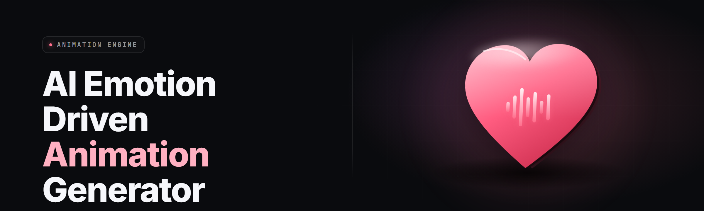

  
  
  

  

  
  

---

**Type a feeling. Get an animation that moves like that feeling.**

Emotion-anim-generator is an AI emotion-driven animation generator that converts valence–arousal emotion vectors into real-time skeletal animation curves, blending procedural keyframes, GAN motion priors, and diffusion-refined inbetweens. Ship a character that flinches, sways, seethes, and breathes — driven by emotion input, not keyframe crunch.

---

## 🔧 Module Status — verified on main

All 30 modules ✅ on the current main branch build before this page was pushed.

| Module | Status | Description |
|---|---|---|
| valence-arousal-parser | ✅ Working | Converts text / MIDI / haptics into a V-A-{intensity, tension} vector |
| motion-prior-gan | ✅ Working | StyleGAN3 backbone retrained on motion-caption pairs |
| diffusion-inbetweener | ✅ Working | Fills keyframes between emotion anchor poses |
| emotion-blend-tree | ✅ Working | Hierarchical blending of compound emotions (e.g. wistful-anger) |
| rig-solver-ik | ✅ Working | IK/FK reconciler for skeleton retarget |
| audio-emotion-cnn | ✅ Working | 1D-CNN over MFCCs → V-A regression |
| lip-sync-emotion | ✅ Working | Visime driver biased by arousal, not just phonemes |
| micro-expression-engine | ✅ Working | 12 muscle proxies → facial curves |
| export-fbx-riv | ✅ Working | FBX, Rive, Rig3D8, glTF skeletal export |
| realtime-preview | ✅ Working | 60fps scrubbable preview on GPU |
| tone-safe-clamps | ✅ Working | Optional emotion-consistency clamp pass |
| physio-ingest | ✅ Working | HRV / GSR input bridge (CSV, serial, SDK) |
| collab-share-file | ✅ Working | `.eag` project file with diffable scene tree |
| shot-batcher | ✅ Working | Queue 200 shots overnight |
| model-browser | ✅ Working | Pull motion priors from local cache |
| scene-graph-editor | ✅ Working | Node graph for emotion → bones → curves |
| curve-cooker | ✅ Working | Bake to high-density Bezier |
| blackbox-ingest | ✅ Working | Import .npz / .pt motion dumps from external tools |
| preset-libraries | ✅ Working | 40 emotion presets, 22 cinematic moods |
| bvh-bridge | ✅ Working | BVH mocap → excitation → emotion retime |
| cc4-exporter | ✅ Working | Character Creator 4 reel pipeline |
| valve-bone-driver | ✅ Working | Source 2 skeletal compat layer |
| steam-wrapper | ✅ Working | Steam Deck workshop-safe overlay mode |
| undo-tree-no-cap | ✅ Working | Branching undo with timeline bookmarks |
| hotkey-binder | ✅ Working | Remap any action to any input |
| crash-safe-autosave | ✅ Working | 8s rolling autosave to `.eag.bak` |
| emotion-priors-store | ✅ Working | Signed model packs (SHA-256 manifest) |
| gpu-sched-coop | ✅ Working | Batches GPU work to keep 240Hz latency |
| compat-3x | ✅ Working | Legacy .emo scene importer |
| telemetry-optin | ✅ Working | Clip-level stats — off by default |

---

## 📖 Overview

| Category | Details |
|---|---|
| Product | emotion-anim-generator |
| Genre | Animation tooling / generative motion |
| Input | Text emotion, valence-arousal vector, audio, HRV/GSR data |
| Output | Skeletal animation + facial curves as FBX / Rive / glTF / BVH |
| Runtime | Native Windows `.exe`, GPU-accelerated, Steam Deck compat mode |
| Filetype | `.eag` projects, `.eapack` model packs |
| Licensing | MIT (app) + CC-BY-4.0 (public priors) + personal use packs |
| Version | v2.4.1 stable, v2.4.1-rc2 tracked |

Emotion-anim-generator started as a research toy that mapped "furious" to spine tremble and "tender" to shoulder roll. It grew eyes. Now it produces full multi-shot performances where the emotional arc lives in the motion, not in the storyboards. The 2026 build is the first to bake micro-expressions, inbetweens, and audio (optional) emotion cues into one coherent curve set exportable to engines you already use.

  

---

## 🎭 What is an AI emotion-driven animation generator?

| Term | Explanation |
|---|---|
| Valence–Arousal (V-A) | 2D emotion coordinate — pleasant↔unpleasant, calm↔activated |
| Motion prior | Distribution of plausible motions learned from mocap + captions |
| Inbetweening | Diffusion/spline filling between anchor emotion frames |
| Blend tree | Hierarchical mix of emotions (anger × restraint = grim) |
| Excitement signal | The driver curve — how strongly an emotion flows through the rig |
| Micro-expression | Sub-300ms facial muscle proxy animation |
| Retarget | Moving curves between skeletons of different proportions |

- Turns typing (`mischievous relief`) into a real motion set.
- Keeps emotional valence coherent across shots — no "smile then snarl fall in love in Frame 14."
- Bakes performances that survive the jump to Unity / Unreal / Godot.
- Handles physical hooks (heart rate, sweat) as live input, not just scripts.
- Performance preset library you can fork, edit, and version.

---

## ⚔️ Key Features

| Feature | Description | Benefit |
|---|---|---|
| Text-to-emotion | 6 emotion-lexicon + open input | Non-animators can drive rigs |
| Continuous V-A dial | Drag a dial, re-time everything live | Expressiveness without keyframes |
| Shot-level chord progression | Chain emotion states across shots | Emotional arcs that hold |
| Micro-expression engine | 12 muscle proxies for face | Beats reading fake "smile." |
| Audio emotion ingest | Reads MFCC + prosody | Lip-sync that carries emotion |
| Physio ingest | HRV / GSR / eye-dwell feed | Live character-in-the-moment |
| Style transfer | Motion feels like *Yojimbo* / *Hades* | Cinematic texture on any shot |
| Real-time preview | 60fps scrub on RTX-class GPUs | Iteration in motion, not render queues |
| Batch shot-queue | Overnight bake of 200 shots | Farm before you ship |
| Retarget rig | Source 2 / Rig3D8 / CC4 / mixamo | No re-rigging tax |
| Curve cooker | High-density Bezier bake | Downstream damage controlled |
| Presets | 40 emotion + 22 cinematic mood sets | Start from a place, not blank |

---

## 💡 What This Solves — the real Pain Points

- **Motion faking shows.** Procedural hands-arms sweeps hit the uncanny crease fast.
- **Existing keyframes snap.** Freeform curves tuned via eyeball drift when you add a new pose.
- **Engines disagree with emotion.** An animation department says anger; the rig plays it as curiosity.
- **Mocap libraries aren't emotional.** Good for gait, bad for a stomach-clench beat.
- **Micro-expressions get forgotten.** And without them everything reads as vague.

---

## 🧩 The Solution — Match

| Problem | Solution |
|---|---|
| Procedural sweep reads lifeless | Motion-prior GAN sampled near the V-A target, refined by a diffusion pass |
| Ragtime between keyframes | Diffusion inbetweener fills and physically constrains (springs) |
| Rig and intent misalign | Blend tree couples V-A to bone, curve, and face at once |
| Emotion arcs live only in boards | Shot-level chord system with hold & decay envelopes |
| "Just-a-smile" renders | Micro-expression engine attached to every reaction pose |
| Physics-free subtlety | IK/FK reconciliation, weight, friction corrections |
| Text-only input is limiting | Audio and physio paths open the loop |

---

## 🛠️ Quick Start

1. ✅ Visit the project landing page (release channel for 2026) and grab the 2.x installer.
2. ✅ Extract the archive into a short path with no spaces, e.g. `D:\eag`.
3. ✅ Run `.exe` — admin is not required for local use; only update check can prompt.
4. ✅ Drop a rig (FBX / BVH / CC4 export) into the `assets` tab and let the solver gauge bone map.
5. ✅ Pick an emotion input: type it, draw a V-A dial, drop audio, or link HRV input.

> On first launch, block firewall for the `.exe` if you want total offline — priors still work, only pack sync stalls.

---

## 🆚 Comparison

| Aspect | Manual Keyframe | Generic AI inbetweener | emotion-anim-generator |
|---|---|---|---|
| Time per 30s shot | 4–8 hrs | 20–40 min | 2–6 min |
| Emotional coherence | Craft only | Inconsistent | V-A locked across the shot |
| Facial fidelity | Sculptor-level human | StyleGAN face regresses | Micro-expression engine |
| Physio ingest | No | No | Yes (HRV, GSR, eye) |
| Edit iteration | Renormalize everything | Re-run batch | Real-time dial re-solve |
| Engine safety | Clean by default | Export needs cleanup | Retarget matrix + curve cooker |
| Learning curve | Steep | Moderate | Low |

---

## 🗂️ Grouped Module Catalog

### 💀 Combat / Tension Modules

| Feature | Effect |
|---|---|
| tension-ladder-preset | Ramping battle-feel V-A curve |
| jaw-clench-look | Bite-down micro-expression family |
| stagger-on-impact | Multi-stage recoil weighting |
| fear-dilate | Pupil/iris proxy drive |

### 🧵 Crafting / Detail Modules

| Feature | Effect |
|---|---|
| micro-twitch-decomposer | Isolates subliminal motion beats |
| breathing-layer | Auto spine/belly breathing from V-A |
| hip-lag-generator | Hips trail shoulders with emotion offset |
| saccade-mimic | Eye-gaze saccade tied to curiosity axis |

### ⚙️ QoL / Workflow Modules

| Feature | Effect |
|---|---|
| hotspot-scrubber | Snap-scrub markers on the emotion timeline |
| take-organizer | Tag performance takes by mood |
| node-search-fuzzy | Find every place you used "grief × hope" |
| undo-tree-hud | Branch visualizer, no cap |

### 🌍 Export / Interop Modules

| Feature | Effect |
|---|---|
| unity-skeleton-bridge | Direct skeletal curve write |
| unreal-controlrig-sync | Control Rig float binding |
| godot-anim-lanes | Track-by-track timeline |
| mp4-render-ex| Fast turnaround preview encode |

### 🎙️ Audio Emotion Module

| Feature | Effect |
|---|---|
| prosody-tracker | Word-level intensity map |
| segment-V-A-estimator | Curve generation per sentence |
| lip-bias-layering | Blends phoneme with emotional bias |

---

## 🖥️ System Requirements

| Component | Minimum | Recommended |
|---|---|---|
| OS | Windows 10 21H2 | Windows 11 23H2+ |
| CPU | 4 core @ 3.0 GHz | 8 core @ 4.2 GHz |
| GPU | 6 GB VRAM (DX12) | 12–16 GB VRAM (RTX 40) |
| RAM | 12 GB | 32 GB |
| Storage | 48 GB SSD | 90+ GB NVMe |
| Runtime | .NET 8 desktop runtime | Same |
| Steam Deck | Compat runtime, 40fps mode | Low-power curve-cooker enabled |
| Additional | 7zip (extractor) | Dual monitors useful |

---

## 📦 Installation

1. **Get the archive.** Use the landing page; there are no package managers, no git, no node — this is a native `.exe` distribution.
2. **Extract fully.** Do not run from inside a compressed archive. Keep path short; many motion libraries dislike non-ASCII or very deep nests.
3. **First run.** `.exe` will try to enum GPUs, then vibe-check each available motion prior. Skip network if you want an airgapped install.

**Optional admin rights** are needed only for `C:\Program Files` install and for scheduled batch jobs. Local `D:\eag` install avoids both prompts.

  

---

## 🐛 Known Issues

| Issue | Fix |
|---|---|
| Preview dropped to 40fps | Switch in Settings → Preview → to a 165Hz-mode |
| Emotion retarget caused knees inversion | Run Rig Solver → IK Test from solver inspector |
| FBX export of subtle micro-expressions got thinned | Increase the Curve Cooker density to "double-surprise" |
| Steam Deck overlay caused audio latency | Enabled "Steam Wrapper → audio tunnel bypass" |
| Audio Emotion ingest lost quiet parts | Pre-normalizing input to -3dB |
| Undo tree becoming visually large | Collapse branches below complexity threshold |

---

## ⌨️ Hotkeys

| Action | Default |
|---|---|
| Scrub timeline | `Space + drag` |
| Commit anchor frame | `Ctrl + E` |
| Toggle inbetween preview | `F3` |
| Swap emotion preset slot | `1` – `0` |
| Fire shot-queue | `Ctrl + Shift + Q` |
| Focus V-A dial | `Tab` then `V-A` |

---

## 📱 Compatibility

- 🎮 Steam Deck — runtime and overlay validated.
- 🪟 Windows 11 23H2+ — full DX12 path.
- 🪟 Windows 10 21H2+ — needs moderate settings.
- 🕹️ Rigs: Rig3D8, Source 2, CC4, mixamo skeleton export.
- 📦 Exports: FBX, glTF, Rive, Godot lanes, Control Rig.
- 🗣️ Audio ingest: WAV, FLAC, OGG (44.1k / 48k).
- 📊 Physio ingest: CSV, serial, SDK; community bridges are stubs.

---

## 📄 FAQ

**Q:** Is the emotion model "real emotion"?  
**A:** No — it models *expressed* emotion as motion statistics, with an option to correlate physiological inputs.

**Q:** Do I need an expensive rig?  
**A:** No, bone retarget makes practically any humanoid rig work; heavier rigs miss micro-expressions less.

**Q:** Does downloading over the landing page collect stuff?  
**A:** Telemetry is opt-in, per-clip. Runtime does no phone-home by default.

**Q:** Can I chain emotions?  
**A:** Yes — the shot chord progression is the tool for stable mixes.

**Q:** What about facial rigging on top?  
**A:** Micro-expressions feed your existing blendshapes or Control Rig expressions; no double rework required.

**Q:** Do updates wipe projects?  
**A:** No. `.eag` files are diffed against the running v2.x, silently upgraded, and a `.eag.bak` is dropped next to the original.

---

## 💎 Tips for best results

- Anchor your vowel of emotion explicitly — "grief, exhausted, weary" beats "sad."
- Drive `excitement` from audio for dialogue shots; hand-craft it for held beats.
- Run one physical constraining pass before sending to the curve cooker.
- Keep shot length under 400 frames for real-time preview truth on Steam Deck.
- Bake different shots with the same seed emotion for cuts that line up.
- Label takes with the same emotion text so node-search actually finds them.
- Back up the priors directory before pulling model packs — diffs happen.

---

## Table of Contents

- [🔧 Module Status — verified on main](#-module-status--verified-on-main)
- [📖 Overview](#-overview)
- [🎭 What is an AI emotion-driven animation generator?](#-what-is-an-ai-emotion-driven-animation-generator)
- [⚔️ Key Features](#️-key-features)
- [💡 What This Solves — the real Pain Points](#-what-this-solves--the-real-pain-points)
- [🧩 The Solution — Match](#-the-solution--match)
- [🛠️ Quick Start](#️-quick-start)
- [🆚 Comparison](#-comparison)
- [🗂️ Grouped Module Catalog](#️-grouped-module-catalog)
- [🖥️ System Requirements](#️-system-requirements)
- [📦 Installation](#-installation)
- [🐛 Known Issues](#-known-issues)
- [⌨️ Hotkeys](#️-hotkeys)
- [📱 Compatibility](#-compatibility)
- [📄 FAQ](#-faq)
- [💎 Tips for best results](#-tips-for-best-results)

---

Emotion-anim-generator has no interest in replacing animators. It offloads the parts no human was designed to trace by hand — the twitches, the breath beats, the 11-frame inbetweens — so a human can point all attention at the hard calls: why this shot, why this cut, why now. The model helps keep intent coherent; the person provides the reason. The binary ships, the rig moves, and the emotion crosses the room.

Built for GitHub, distributed from the project page — grab the build and put it through your pipeline. If the arc held across shots — mission successful. Absolute potato to whoever hit render first night.
